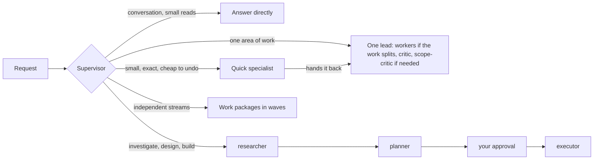
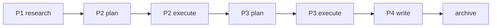
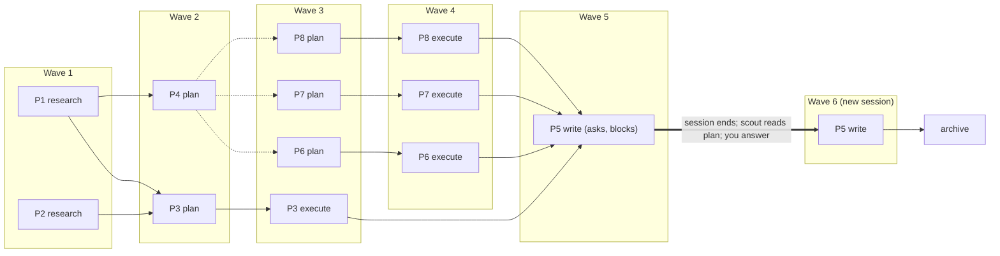

# Supervisor for Antigravity

Supervisor for Antigravity is a multi-agent orchestration layer for Google Antigravity (agy CLI
and Antigravity IDE). It is centered around a single supervisor agent that dispatches tasks based
on scope and complexity. The supervisor answers simple questions itself, sends small exact tasks
to a fast, cheap agent, and gives larger work to a lead agent. The lead splits the work across
parallel workers when it has several independent parts, otherwise does it itself, and has critic
agents review the result for quality and scope.

*Supervisor for Antigravity is an independent project, not affiliated with or endorsed by Google.*

## What It's For

Supervisor for Antigravity is built for long-horizon software and scientific-research tasks:
complex, multi-session work that benefits from a research-plan-execute loop and persistent short-
and long-term memory. For smaller one-off tasks, plain `agy` is likely more effective.

- **Parallel work:** a plan splits large jobs into independent pieces (work packages) that run side
  by side (waves).
- **Project memory:** `.supervisor/` holds memory, committed or kept local, designed after
  project-management practice: long-term goals, mid-term task cards, and short-term plans, plus a
  decision log, facts, conventions, and approved lessons learned. Plan files hold state, so work
  resumes in a new session. See [Persistence And Memory](#persistence-and-memory).

## Quick Start

Requirements:
- Google Antigravity (`agy` CLI or Antigravity IDE) installed
- `python3` 3.9 or newer, on macOS or Linux
- `git`, to clone and for `update`

```bash
git clone https://github.com/sly2j/agy-supervisor.git ~/Work/agy-supervisor
cd ~/Work/agy-supervisor
./deploy install     # plugin in ~/.gemini/config/plugins/agy-supervisor, launcher in ~/.local/bin
agy-supervisor
```

`install` prints a WARNING if `~/.local/bin` is not on your `PATH`. To add it, run this, then open
a new terminal (use `~/.bashrc` for bash):

```bash
echo 'export PATH="$HOME/.local/bin:$PATH"' >> ~/.zshrc
```

For other options, see [Choosing An Install](#choosing-an-install).

Notes:
- If `install` prints ERROR, see [Troubleshooting](#troubleshooting).
- To let Antigravity install it instead, run `agy` inside the clone and say *"deploy this pack"*;
  it follows [docs/deploy.md](docs/deploy.md).

## Using It

The pack is one supervisor, four leads for larger work, their workers, two reviewers, and a few
quick specialists. Who handles what:
- `supervisor`: your session; routes requests, briefs agents, and reports back
- `researcher`: investigation, code tracing, literature; writes
  `.supervisor/working/research/research-*.md`
- `planner`: decision-and-outline plans, questions first, in
  `.supervisor/working/plans/plan-*.md`
- `executor`: code, tests, config, agent definitions, git conflicts, Python environments; works
  in a worktree and lands its change sets locally
- `writer`: scientific and technical prose, slide content, project docs
- `researcher-worker`, `planner-worker`, `executor-worker`, `writer-worker`: the parallel workers
  a lead dispatches; you never call them yourself
- `critic`, `scope-critic`: review a lead's result, for quality and, when needed, for scope creep
- `fixer`: small, exact edits; runs a given command; removes recorded test residue
- `curator`: closes out finished plans into memory and the archive; adds and archives tasks;
  handles "remember X" / "forget X" / "make this a project"
- `git-ops`: routine git with guardrails
- `scout`: read-only lookups

Just ask for what you want. The supervisor picks the path:

| Situation | Path | Why |
|---|---|---|
| Conversation, general advice, one or two small reads | The supervisor answers directly | Nothing to delegate |
| Fully specified, small, local, no design decision, cheap to undo | One quick specialist: `fixer`, `git-ops`, or `scout` | Cheapest path, no review loop |
| Specified and local, but it needs a design call or is not cheap to undo | One lead and one review round | Too much for a quick specialist, less than the full loop |
| Anything else in one area of work | One lead (`researcher`, `planner`, `executor`, or `writer`) with workers when the work splits, and review | Design judgment gets reviewed |
| Investigation, then design, then code | `researcher` -> `planner` -> your approval -> `executor` | You approve the plan before code is written |
| Streams that each need their own research, plan, or write stage | Work packages, run in waves | Independent streams run in parallel |
| "review this diff/plan/draft" | Reviewers only, no edits | You asked for a review |
| A quick specialist finds the task bigger than it looked | Re-routed to one lead, with the specialist's findings | The quick tier no longer fits |

To choose yourself, say "quick" or "just do it" for a quick specialist, or "full", "thorough",
or "with review" for a lead.

Skills you run yourself:
- `/meeting-summary <transcript> [notes]`: minutes from a meeting transcript
- `/project-backup`: timestamped, verified zip backup with retention
- `/close-out [retry]`: tear down residue, record and archive what the work taught, and print the
  `Session state:` line
- `/pick-up [<plan path> | <card>...]`: resume a plan after `/clear` or in a new session, or pick
  one or more tasks when none is live
- `document-extraction`, `email-extraction`: the substance of a document or email thread, as
  notes to write from
- `/supervisor-config critic claude|codex|status`: switch the critic between Claude and Codex
  from inside a session (see
  [Optional: External Critic (Claude or Codex)](#optional-external-critic-claude-or-codex))

The full inventory, with models, effort, workers, reviewers, and internal skills, is in
[docs/architecture.md](docs/architecture.md#agents).

Terms you will meet in answers before any doc defines them:
- **Work package, wave, program:** a plan splits a large job into packages; the packages whose
  inputs are ready run together as a wave; a plan with packages is a program.
- **Residue:** what tests and smoke runs leave behind; recorded as it is made and removed
  at the end, so you see only what could not be removed.
- **`Session state:`** the last line after a close-out or a finished wave: whether `/clear` is safe
  and how to resume ([key](docs/workflow-lifecycle.md#prompts-and-answers)).
- **`Run yourself:`** the one block at the end of an answer with the steps only you can run.
- **`not stored:`** the note you get outside a project when something would have been remembered
  ([details](docs/workflow-lifecycle.md#without-a-memory-store)).
- **Plugin, tag, launcher:** an install lives in its own Antigravity plugin dir
  (`~/.gemini/config/plugins/agy-<tag>`) and is started with `agy-<tag>`; the default tag is
  `supervisor`.
- **Tracked, local, external store:** where a project's memory lives; see
  [Persistence And Memory](#persistence-and-memory).

## How It Works

**The full loop** (Mode 1 in [docs/architecture.md](docs/architecture.md#mode-1-the-full-loop)).
The supervisor hands the task to a lead. The lead splits the work across parallel agents when it has
several independent parts, otherwise does it itself, and has the result reviewed: `critic` checks
quality, and when the findings or the result are large, `scope-critic` checks both for bloat and
scope creep. The lead fixes what matters, up to three rounds (one for plans, since you review the
plan next). A `REVIEW.md` at your repo root adds your own review rules.

**The quick tier** (Mode 2). Small edits, routine git, and read-only lookups go to a fast, cheap
specialist with no review. If the task turns out bigger than it looked, the specialist hands it
back and the supervisor re-routes it to a lead.



**Why this design.** Long contexts fail in known ways: a bad fact gets repeated, the model leans on
its history over its training, extra tools and stale facts crowd out the task. These failures get
worse as context accumulates over a long task or a long project history. Supervisor for Antigravity
is built to counter these failures. Context quarantine and offloading are central to the design:
the supervisor reads almost nothing, every lead and worker gets a fresh window and returns a capped
report, and plans and research live in files. See
[docs/context-engineering.md](docs/context-engineering.md) for the design rationale.

## Larger Work

Larger work runs as a chain: `researcher` -> `planner` -> your approval -> `executor`. The
supervisor skips any stage that adds nothing; a bug with an obvious fix goes straight to
`executor`. Plans and research land in your project's `.supervisor/working/` (`plans/plan-*.md`,
`research/research-*.md`), so you can read and annotate them between steps; finished ones move to
`.supervisor/archive/working/`.

A plan splits a large job into work packages when its streams each need their own research, plan,
or write stage; plain parallel work stays a flat plan. Each package lists only the stages it needs
and depends only on the packages whose output it consumes.

The supervisor runs packages in waves. Each wave runs, all at once, the next stage of every
unblocked package whose dependencies are done. After each wave you see a status table of every
package and the questions the leads raised. A question blocks its package until you answer, in this
session or a later one; the plan file holds the state and a log of what ran and what is still open.

A chain, where each package consumes the one before it: six stages, six waves.



A graph: P4's plan splits it into P6, P7, and P8; P5 asks a question in wave 5 and blocks; in a
new session you answer, and wave 6 re-runs P5.



How the plan file records its packages and its log, and what happens at close-out, is in
[docs/architecture.md](docs/architecture.md#mode-1-the-full-loop).

## Workflow Lifecycle

Every piece of work ends the same way: temporary artifacts are torn down, what the project learned
is recorded, and the supervisor closes with a `Session state:` line that says whether `/clear` is
safe and how to resume. Steps only you can run are collected in one `Run yourself:` block.
[docs/workflow-lifecycle.md](docs/workflow-lifecycle.md) walks small, medium and large work through
open, approval, close-out, clearing and resuming, with the prompts to type and the answers to
expect.

## Persistence And Memory

Supervisor for Antigravity keeps a per-project memory store in `.supervisor/`, committed with the
repo or kept local. Agents read it when they start work and keep it current as they go, so
decisions, facts, conventions and lessons survive across sessions; a committed store also shows
up in `git log`, can be reviewed in a pull request, and reaches your collaborators. On a project
that runs for weeks, this keeps last week's decisions and a researcher's findings from being lost
or rediscovered.

This is separate from Antigravity's own memory. Your user `GEMINI.md`, `GEMINI.local.md`, and
`AGENTS.md` hold rules and preferences; `.supervisor/` holds what the project itself needs to
remember.

The memory model:

- **What is in it:** long-term entries in `memory/<kind>/` (decisions, facts, goals, conventions,
  and lessons; a lesson is recorded only after you approve it), mid-term task cards in `tasks/`
  (one card per task), and short-term plans and research in `working/`. Finished and superseded
  items move to `archive/`. `.supervisor/README.md` explains the layout.
- **How agents use it:** a lead reads the relevant entries when it starts. What you decide while a
  plan runs is written into the plan's log, so it survives `/clear`. At close-out, `curator` turns
  what the work taught into long-term entries, archives the finished plans and research, and
  finishes the task cards.
- **Your controls:** tell supervisor to "remember X", to "forget X", or to "make this a project".
- **Tasks:** `/pick-up` lists open tasks, claims the ones you pick (quick fixes aside) and routes
  them as one request typed in. A session already in a linked worktree lists and claims there. You
  can also type "show tasks", "add a task: ...", "block <task>: <reason>", "release <task>" or
  "drop <task>"; finished tasks are in `.supervisor/history.md`. In a tracked store a claim shows
  to other clones once pushed, in a local store only to this checkout, and in an externalized
  store live to every linked checkout. A `.supervisor/roadmap.md` from an earlier version becomes
  tasks automatically.
- **Where it applies:** only in a project: a folder inside a git repository, or one that holds (or
  sits under one that holds) `.supervisor/`, `GEMINI.md`, `GEMINI.local.md`, or `AGENTS.md`, or
  one you told supervisor to make a project. Your home directory never counts.
- **Tracked or local, your choice:** before creating the store in a git repo, supervisor asks once.
  - **Tracked:** committed with the rest of your repo, so the memory is part of the repo history,
    shows up in pull requests, and reaches collaborators and other checkouts; a worktree's store
    belongs to its branch and lands with it.
  - **Local:** listed in the repo's git exclude file (`.git/info/exclude`, never `.gitignore`) and
    never committed, so nothing of the workflow enters the repo, which suits open-source and shared
    repos; it works only in that checkout.
  - **External:** `agy-supervisor memory externalize` moves a local store to a directory outside
    the repo that your linked worktrees share and that you can keep in your own git repo; see
    [docs/local-memory.md](docs/local-memory.md).

## Branches, Worktrees And Versions

In a git repo, `executor` works on its own branch in a worktree under
`<repo>/.agents/worktrees/<slug>` and, when the checks pass, lands it locally as one squash commit.
Nothing is pushed without your go-ahead. Quick edits, conflict resolution, environment repair,
and repos with submodules work in the current checkout, as does anything you ask to run
"in place". No version is created or bumped unless your repo opts in; versioning follows
`GEMINI.md` rules (`X.y`). A sentence in your repo's `GEMINI.md` overrides any of these;
there is no config file. The details are in [docs/architecture.md](docs/architecture.md#git-work).

Outside a project (see [Persistence And Memory](#persistence-and-memory)) nothing is persisted:
no worktree, no version, no question.

## Choosing An Install

| Install | Where | Start it with |
|---|---|---|
| `./deploy install` | Global plugin in `~/.gemini/config/plugins/agy-supervisor` | `agy-supervisor` |
| `./deploy install --tag <t>` | Tagged plugin in `~/.gemini/config/plugins/agy-<t>` | `agy-<t>` |
| `./deploy install --workspace <dir>` | Workspace plugin in `<dir>/.agents/plugins/agy-supervisor` | plain `agy` |

- Supervisor for Antigravity installs by default as a global plugin
  (`~/.gemini/config/plugins/agy-supervisor`) with its own launcher `agy-supervisor`. Plain `agy`
  stays plain Antigravity.
- A tagged install (`--tag <t>`) lets you run alternate versions or configurations side by side
  under `~/.gemini/config/plugins/agy-<t>` with launcher `agy-<t>`.
- A workspace install (`--workspace <dir>`) scopes the plugin to a specific repository or project
  directory under `<dir>/.agents/plugins/agy-supervisor`.
- `--prefix <dir>` (default `~/.local`) puts the launcher in `<dir>/bin` and the update registry
  under `<dir>/state`.

The launcher defaults to `gemini-4-carbon-medium` (Carbon medium default). Override via CLI
`--model <id>` or environment variable `AGY_SUPERVISOR_MODEL`. See
[docs/deploy.md](docs/deploy.md#launcher-model-configuration).

## Optional: External Critic (Claude or Codex)

Every agent in the pack runs on Antigravity, including the `critic` that reviews a lead's
result. You can run that one agent on Anthropic's Claude CLI (`claude`) or OpenAI's Codex CLI
(`codex`) instead, so the work and its review come from different model families with different
blind spots. Only the critic changes: `scope-critic`, the leads and the workers stay on
Antigravity.

It is off by default. Turning it on spends your Anthropic or OpenAI quota and sends repository
content to that provider; `enable` states exactly what and asks for a yes ([consent, cost and
data flow](docs/deploy.md#consent-cost-and-data-flow)). You need the `claude` or `codex` CLI on
`PATH`, logged in.

```bash
agy-supervisor critic enable [claude|codex]  # asks once; optional [model] picks another model
agy-supervisor critic status                 # backend, model, CLI login, permission rule
agy-supervisor critic disable
```

From inside a session, `/supervisor-config critic claude|codex [model]|status` switches the
critic or reports status; enabling costs one permission prompt, so no agent can turn an external
critic on unasked. A switch takes effect from the next task, with no reinstall.

When the external critic cannot review (not installed, not logged in, a timeout, an error), that
round falls back to the native Antigravity `critic` and the answer says so. Per-domain model
overrides and the caveats are in [docs/deploy.md](docs/deploy.md#external-critic-claude-or-codex).

## Documentation

In reading order:

- [docs/workflow-lifecycle.md](docs/workflow-lifecycle.md): what you type, what comes back, what
  is on disk, when `/clear` is safe and how to resume. Read this before your first multi-session
  task.
- [docs/architecture.md](docs/architecture.md): every agent and skill, which model and tools each
  has, what the pack does in git, and the memory layout. Read this when you want to know who
  did what.
- [docs/deploy.md](docs/deploy.md): the install runbook: update, switch model, enable external
  critic, fix an install. Read this when installing on another machine, changing configuration,
  or when something broke; the Quick Start covers the first install.
- [docs/local-memory.md](docs/local-memory.md): keeping a project's memory outside the repo,
  shared across worktrees and machines. Read this when the repo cannot hold the store.
- [docs/context-engineering.md](docs/context-engineering.md): why it is built as one supervisor
  plus fresh-window agents and files, and what that asks of you. Read this when you wonder why it
  works this way.

## Maintaining An Install

Day to day, the launcher is all you need:

```bash
agy-supervisor update             # update this install; --all updates every install
agy-supervisor status             # installed version and per-file state
agy-supervisor list               # every registered install: name, version, mode, target
agy-supervisor --version          # pack and agy versions; -h lists the launcher's commands
agy-supervisor uninstall          # delete this install: its plugin dir plus its launcher
agy-supervisor doctor             # check environment and install health
```

`update` reinstalls from the cached pack snapshot (or `--from DIR`), preserving files you edited
in the install dir unless `--force` is passed. `uninstall` asks you to confirm; run it with
`--dry-run` first. A plugin installed with `--tag foo` has the launcher `agy-foo`, which takes the
same commands.

The `./deploy` script in your checkout can act on any install. Use it for the first install, for
`doctor`, and for workspace installs:

```bash
./deploy install                  # deploy the checkout as it is, local edits included
./deploy doctor                   # PASS/WARN/FAIL checks on the environment and the install
./deploy update --all             # every registered install; --tag <t> for one
./deploy uninstall --dry-run      # then --yes to remove the plugin files and launcher
```

`install`, `doctor`, `status`, `update`, and `uninstall` take `--tag <t>`, `--workspace <dir>`, or
`--prefix <dir>` to pick the install (the default global plugin when none is given). The full
reference (`--from`, `--force`, `--source`, the registry and the copy of `deploy` each install
keeps) is in [docs/deploy.md](docs/deploy.md).

Major changes per version are in [CHANGELOG.md](CHANGELOG.md).

## Troubleshooting

| Symptom | Fix |
|---|---|
| `agy-supervisor: command not found` | Add `~/.local/bin` (or `<prefix>/bin` for a `--prefix` install) to `PATH` |
| Plugins or agents don't show up in `agy` | Ensure plugin is enabled in `~/.gemini/config/config.json`. Run `agy-supervisor doctor` |
| `install` or `update` reports modified file conflict | Expected: local edits in install dir are preserved. Pass `--force` to overwrite |
| `exists but is not managed by this pack` | An unmanaged file shadows a pack file. Rename yours or pass `--force` to replace it |
| `was installed with --prefix X` | Pass `--prefix X` |
| `exists and is not an agy-supervisor launcher` | Move that file aside, or choose another `--tag` or `--prefix` |
| `another deploy is running` | Wait for the lock to clear, then re-run |
| `is not registered under prefix X` | Run `./deploy install` once (pass `--prefix` if you installed with one) |
| `settings.json` missing scoped review rule | Run `agy-supervisor doctor` or reinstall with `./deploy install` to restore permission rule |
| External critic fails or times out | Verify `claude` or `codex` is logged in; review falls back to native Antigravity `critic` |

## Repository Layout

```
pack/agents/        agent definitions (deployed to <install dir>/agents)
pack/skills/        skills (deployed to <install dir>/skills)
deploy              installer: install | update | status | list | uninstall | doctor | memory | critic
tests/              deploy tests, pack lint, VERSION check
docs/               workflow-lifecycle.md, architecture.md, deploy.md, local-memory.md, context-engineering.md
GEMINI.md           instructions for Antigravity working in this repo
REVIEW.md           review rules for this repo
.supervisor/        project memory; tasks/ holds open work items, one card per task
VERSION             pack version
CHANGELOG.md        major changes per version
LICENSE             Apache License 2.0
```

To edit the pack, follow [GEMINI.md](GEMINI.md).

## License

Licensed under the Apache License, Version 2.0. See [LICENSE](LICENSE).
